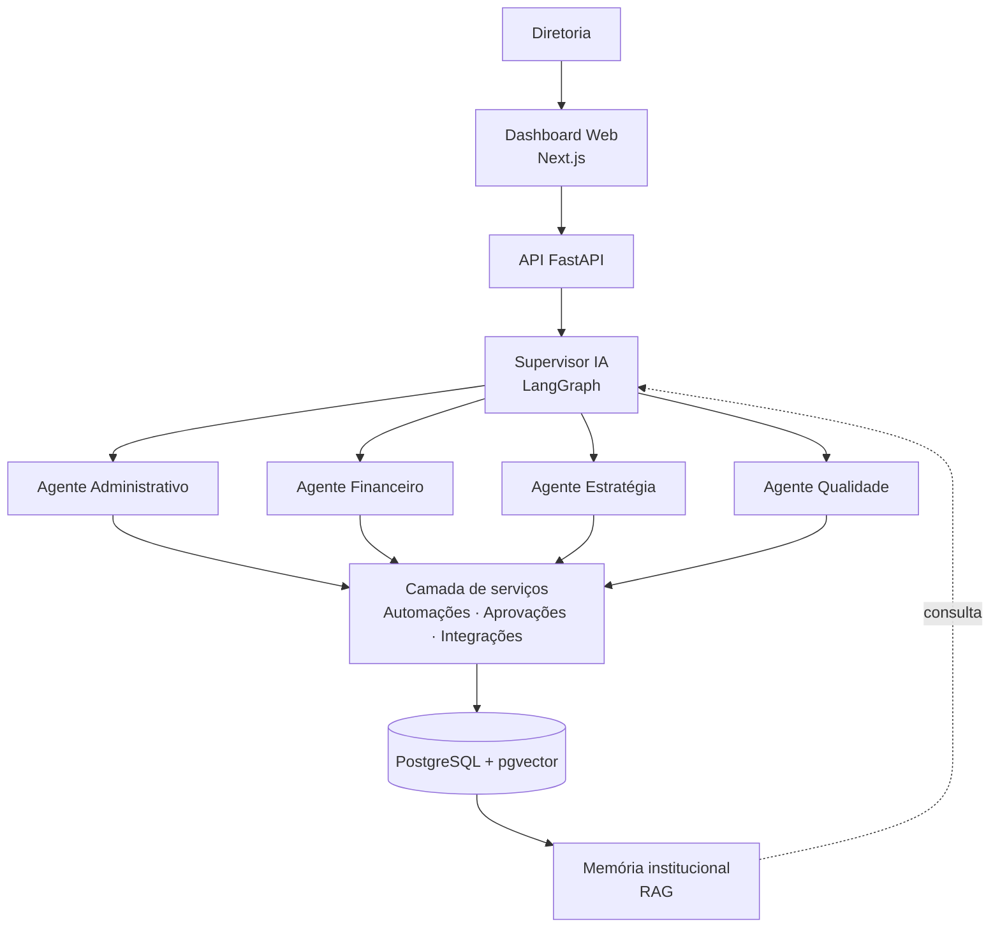
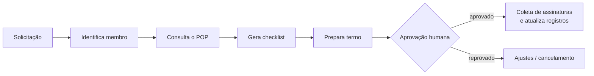
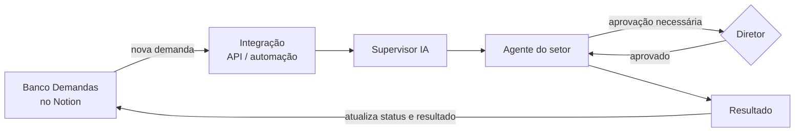
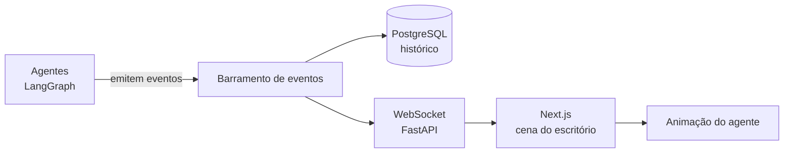

# 🤖 DPR AI Office

**Escritório de agentes de IA da Diretoria de Presidência (DPR) da Byron Solutions: um agente para cada setor, coordenados por um Supervisor.**

> Transformando processos administrativos em inteligência, automação e estratégia.


---

## Sumário

- [Sobre o projeto](#sobre-o-projeto)
- [A DPR e seus setores](#a-dpr-e-seus-setores)
- [Arquitetura](#arquitetura)
- [Agentes](#agentes)
- [Memória institucional (RAG)](#memória-institucional-rag)
- [Fluxos automatizados](#fluxos-automatizados)
- [Central de demandas](#central-de-demandas)
- [Segurança e autonomia controlada](#segurança-e-autonomia-controlada)
- [Escritório virtual](#escritório-virtual)
- [Dashboard web](#dashboard-web)
- [Stack](#stack)
- [Estrutura de diretórios](#estrutura-de-diretórios)
- [Como rodar](#como-rodar)
- [Roadmap](#roadmap)
- [Requisitos não funcionais](#requisitos-não-funcionais)
- [Escopo e limites](#escopo-e-limites)
- [Evolução futura](#evolução-futura)

---

## Sobre o projeto

A DPR é dividida em quatro setores e todos os diretores são capacitados para atuar em qualquer um deles. O **DPR AI Office** reproduz essa estrutura em software: **um agente de IA por setor**, mais um **Supervisor** que recebe as demandas, escolhe quem executa e consolida os resultados.

**Objetivos**

- Reduzir o trabalho operacional da diretoria.
- Automatizar contratos, certificados, termos e demais fluxos administrativos.
- Manter o controle financeiro e a previsão de caixa sempre atualizados.
- Tornar metas e indicadores mensuráveis (OKRs).
- Padronizar e documentar as atividades da empresa.
- **Preservar o conhecimento entre gestões** por meio de uma memória institucional.
- **Tornar o trabalho dos agentes visível:** um escritório virtual no site, onde cada agente aparece na sua mesa executando as tarefas em tempo real.

## A DPR e seus setores

| Setor | O que faz hoje |
|---|---|
| **Administrativo** | Contratos (redação e revisão), documentações (assinaturas, validação de certificados e horas, Selo EJ), controle (dados dos membros, organização da empresa), termos (voluntariado, desligamento e termos contratuais) |
| **Financeiro** | Pagamentos e recebimentos (parcelas a pagar e a receber, prazos, notas fiscais), planejamento financeiro (previsão de caixa, adaptações, entradas e saídas futuras), fluxo de caixa (caixa inicial e final, transações, comprovantes) |
| **Estratégia** | OKRs (definição de metas, análise de melhorias, dados mensuráveis), estudo de novas ferramentas (Make, Power BI), benchs com outras EJs (reuniões e aprendizado) |
| **Qualidade** | Automatizações (contratos, certificados, termos), mapeamentos (descrição e padronização de atividades, fluxogramas) |

## Arquitetura

Três camadas: **inteligência** (agentes), **operacional** (serviços, automações, banco e integrações) e **apresentação** (dashboard web).



## Agentes

### Supervisor IA

Recebe as solicitações, interpreta a demanda, identifica o agente responsável (ou mais de um), distribui as tarefas, acompanha a execução, consolida resultados, trata falhas, encaminha operações críticas para aprovação humana e mantém o histórico.

### Agente Administrativo

| Área | Funções |
|---|---|
| Contratos | Redigir contratos a partir de modelos; revisar e comparar com o modelo oficial; apontar cláusulas inconsistentes e informações ausentes |
| Documentações | Controlar assinaturas pendentes; validar certificados e horas; apoiar o processo do Selo EJ |
| Controle | Manter os dados dos membros e a organização da empresa |
| Termos | Preparar termos de voluntariado, de desligamento e termos contratuais |

> ⚠️ A análise de contratos é ferramenta de apoio. Não substitui avaliação jurídica nem a aprovação dos responsáveis.

### Agente Financeiro

| Área | Funções |
|---|---|
| Pagamentos e recebimentos | Acompanhar parcelas a pagar e a receber, prazos e notas fiscais; alertar sobre vencimentos |
| Planejamento financeiro | Prever o caixa futuro, estimar entradas e saídas e sugerir adaptações |
| Fluxo de caixa | Calcular caixa inicial e final, registrar e categorizar transações, conferir comprovantes e apontar inconsistências |

Os dados financeiros chegam em **arquivos `.xlsx`**, então a leitura e a validação dessas planilhas são a base do agente.

### Agente Estratégia

| Área | Funções |
|---|---|
| OKRs | Apoiar a definição de metas, tornar dados mensuráveis e analisar pontos de melhoria |
| Estudo de ferramentas | Pesquisar e comparar ferramentas (como Make e Power BI) e registrar os aprendizados |
| Benchs | Preparar e registrar benchs com outras EJs, extraindo boas práticas |
| Relatórios | Consolidar indicadores e diagnósticos para reuniões da diretoria |

### Agente Qualidade

| Área | Funções |
|---|---|
| Automatizações | Manter e evoluir os fluxos de contratos, certificados e termos |
| Mapeamentos | Descrever e padronizar atividades, gerar fluxogramas, identificar gargalos e tarefas repetitivas |
| Documentação | Manter os procedimentos (POPs) atualizados |

## Memória institucional (RAG)

Base de conhecimento centralizada que preserva o que a Byron já aprendeu. Os agentes consultam os documentos **antes** de responder, usando **RAG** sobre embeddings no pgvector.

- **Conteúdo:** POPs e processos, modelos de contratos, termos e certificados, relatórios financeiros, OKRs, registros de benchs, estudos de ferramentas e decisões de gestões anteriores.
- **Recursos:** busca por palavra-chave e semântica, **indicação da origem** de cada informação e atualização controlada dos documentos.

## Fluxos automatizados

Os agentes executam fluxos completos, sempre com aprovação humana nas etapas críticas.

**Exemplo: desligamento de membro**



**Outros fluxos:** emissão e validação de certificados, redação e revisão de contratos, termos de voluntariado, fechamento financeiro, prestação de contas e geração de relatórios.

## Central de demandas

A diretoria pede o trabalho aos agentes por **três canais**. Todos caem no mesmo lugar: o Supervisor cria uma tarefa com responsável, prioridade, prazo e status.

| Canal | Como funciona |
|---|---|
| **Chat com o Supervisor** | Pedido em linguagem natural (ex.: "revisa o contrato da empresa X e me diz o que falta"). O Supervisor identifica o setor e, se faltar informação, pergunta de volta |
| **Formulário de tarefa** | Escolhe o setor (ou deixa o Supervisor decidir), define prioridade e prazo e anexa arquivos, como um `.xlsx` do caixa ou um contrato |
| **Notion** | Demandas criadas no Notion, onde ficam todas as informações da EJ, são lidas e executadas pelos agentes |

Também é possível mandar a demanda clicando direto na mesa de um agente no [escritório virtual](#escritório-virtual).

### Demandas pelo Notion

O Notion é a fonte principal de informações da Byron, então a diretoria pode pedir tarefas sem sair dele. A proposta é um banco de dados **Demandas** no Notion que os agentes acompanham:

| Propriedade | Uso |
|---|---|
| Título e descrição | O que precisa ser feito |
| Setor | Administrativo, Financeiro, Estratégia, Qualidade ou "Supervisor decide" |
| Prioridade e prazo | Ordem de execução e alertas |
| Anexos ou links | Documentos de apoio |
| Status | Espelha o status da tarefa no sistema |
| Resultado | Link para o documento, relatório ou resposta gerada |



**Como funciona**

1. Um diretor cria uma demanda no banco do Notion.
2. A integração detecta a nova página e a envia ao Supervisor.
3. O Supervisor interpreta, escolhe o agente e cria a tarefa no sistema, guardando o ID da página do Notion.
4. O agente executa, consulta a memória institucional quando precisar e gera o resultado.
5. O status e o resultado são escritos de volta na própria página do Notion.
6. Operações críticas ficam em `Aguardando aprovação` até um diretor confirmar, no Notion ou no escritório virtual.

**Cuidados**

- **Sem duplicidade:** o ID da página do Notion identifica a demanda, para que ela não seja executada duas vezes.
- **Quem pode pedir:** só membros autorizados, respeitando o RBAC. Pedidos de áreas restritas (financeiro, dados de membros) exigem a permissão correspondente.
- **Faltou informação:** o agente comenta na página do Notion pedindo o que falta, em vez de assumir.
- **Escopo limitado:** a integração acessa apenas os bancos e páginas liberados para ela.

**Notion também como fonte de conhecimento:** os POPs, modelos e registros que já estão no Notion podem ser sincronizados com a [memória institucional](#memória-institucional-rag), mantendo a origem de cada informação.

**Outros canais futuros:** e-mail e WhatsApp.

### Gerenciamento de tarefas

Cadastro de solicitações, responsáveis, prioridades, prazos, aprovações e histórico de execução.

**Status:** `Pendente` · `Em andamento` · `Aguardando aprovação` · `Concluída` · `Cancelada` · `Com erro`

## Segurança e autonomia controlada

Controle de acesso por função (**RBAC**) para usuários e agentes, com autenticação, permissões por setor, proteção de dados confidenciais e de chaves de API, registro de alterações e histórico de aprovações.

| Operação | Permissão |
|---|---|
| Gerar relatórios | 🤖 Automática |
| Analisar e comparar contratos | 🤖 Automática |
| Redigir minutas de contratos e termos | 🤖 Automática (rascunho) |
| Preparar desligamento | 🤖 Automática |
| Gerar certificados | ✅ Com validação |
| Validar certificados, horas e Selo EJ | ✅ Com validação |
| Alterar registros financeiros | 🔑 Conforme autorização |
| Aprovar desligamento | 👤 Humana |
| Aprovar e assinar contratos e termos | 👤 Humana |
| Efetuar pagamentos | 👤 Humana |

**Nenhuma operação crítica é executada sem as autorizações necessárias.**

## Escritório virtual

Além do dashboard tradicional, o site tem uma página **Escritório**: uma visão 2D de um escritório onde cada agente tem a sua mesa e é animado conforme o que está fazendo de verdade no backend. A ideia é que qualquer diretor entenda, em segundos, **quem está trabalhando em quê**.

```text
┌───────────────────────────────────────────────────────────┐
│  🏢 Escritório DPR                                        │
│                                                           │
│   [Administrativo]     [Financeiro]                       │
│    🧑‍💻 digitando        🧑‍💻 lendo planilha                 │
│    "Revisando contrato" "Conferindo fluxo de caixa"       │
│                                                           │
│          [ Supervisor ] 🧑‍💼 distribuindo tarefas           │
│                                                           │
│   [Estratégia]         [Qualidade]                        │
│    🧑‍💻 pesquisando      🧑‍💻 desenhando fluxograma          │
└───────────────────────────────────────────────────────────┘
```

### O que o usuário vê

- Uma mesa por agente (Administrativo, Financeiro, Estratégia e Qualidade) e a mesa do Supervisor no centro.
- **Estado visual do agente**, ligado ao status da tarefa:

| Estado do agente | Animação | Corresponde a |
|---|---|---|
| Ocioso | Sentado, parado | Sem tarefa |
| Trabalhando | Digitando, com balão da tarefa atual | `Em andamento` |
| Consultando a memória | Folheando documentos / indo à estante | Busca RAG em andamento |
| Entregando | Caminha até a mesa de outro agente ou do Supervisor | Repasse de tarefa entre agentes |
| Aguardando aprovação | Levanta a mão, ícone de alerta | `Aguardando aprovação` |
| Com erro | Ícone vermelho sobre a mesa | `Com erro` |
| Concluído | Check verde por alguns segundos | `Concluída` |

- **Clique na mesa** para abrir um painel lateral com a tarefa atual, o histórico recente, as fontes consultadas e os botões de aprovar ou rejeitar quando houver aprovação humana pendente.
- Uma **linha do tempo** com os eventos em tempo real (por exemplo: "Supervisor repassou *Revisar contrato X* ao Administrativo").

### Como funciona

O escritório é apenas uma **visualização**: toda a lógica continua no backend. Cada ação relevante dos agentes gera um evento, que o frontend recebe em tempo real e traduz em animação.



Exemplo de evento:

```json
{
  "agent": "financeiro",
  "state": "working",
  "task_id": "t-1042",
  "message": "Conferindo fluxo de caixa de outubro",
  "timestamp": "2026-11-07T14:32:10Z"
}
```

- **Eventos:** `task_started`, `task_handoff`, `memory_lookup`, `approval_requested`, `task_completed`, `task_failed`.
- **Persistência:** os mesmos eventos alimentam o histórico de execução e a rastreabilidade, então o escritório e a auditoria usam a mesma fonte.
- **Renderização:** canvas 2D com sprites (por exemplo PixiJS ou Phaser) dentro de um componente React. Pixel art encaixa bem no estilo e é leve para animar.
- **Permissões:** o escritório respeita o RBAC. Quem não tem acesso ao setor Financeiro vê o agente trabalhando, mas sem o conteúdo da tarefa.
- **Acessibilidade:** modo de visão simplificada (lista de agentes e status) para telas pequenas e para quem prefere menos animação.

## Dashboard web

| Módulo | Conteúdo |
|---|---|
| **Visão geral** | Indicadores principais, solicitações recentes, alertas e pendências |
| **Administrativo** | Contratos, assinaturas pendentes, certificados e horas, termos, cadastro de membros |
| **Financeiro** | Parcelas a pagar e receber, notas fiscais, fluxo de caixa, previsão |
| **Estratégia** | OKRs, benchs, estudos de ferramentas, relatórios |
| **Qualidade** | Fluxogramas, POPs, automações, gargalos |
| **Escritório** | Visão animada dos agentes trabalhando nas suas mesas, em tempo real |
| **Demandas** | Nova demanda (chat ou formulário), fila, status, origem (site ou Notion) e aprovações pendentes |
| **Agentes** | Tarefas em execução, histórico, resultados e erros |
| **Memória institucional** | Pesquisa de documentos e histórico de decisões |

Indicadores acompanhados: saldo, receitas e despesas mensais, previsão de caixa, processos concluídos e pendentes, tempo médio de execução, documentos emitidos, metas dos OKRs e evolução entre gestões. Os painéis também poderão ser publicados no Power BI.

## Stack

| Tecnologia | Aplicação |
|---|---|
| Python | Agentes e regras de negócio |
| LangGraph | Orquestração dos agentes |
| LLM / API | Processamento de linguagem |
| FastAPI | API backend |
| Make / n8n | Automações e integrações |
| Notion API | Receber demandas, devolver status e resultados e sincronizar conhecimento |
| PostgreSQL + pgvector | Banco principal, busca semântica e embeddings |
| Next.js + React | Interface web |
| WebSocket (FastAPI) | Eventos em tempo real para o escritório virtual |
| PixiJS ou Phaser | Renderização 2D do escritório e animação dos agentes |
| Power BI | Dashboards e indicadores |
| Docker | Containerização e implantação |
| Git / GitHub | Versionamento e colaboração |

## Estrutura de diretórios

```text
dpr-ai-office/
├── backend/
│   ├── app/
│   │   ├── agents/
│   │   │   ├── supervisor/
│   │   │   ├── administrativo/
│   │   │   ├── financeiro/
│   │   │   ├── estrategia/
│   │   │   └── qualidade/
│   │   ├── api/
│   │   ├── core/
│   │   ├── services/        # leitura de xlsx, geração de documentos, etc.
│   │   ├── workflows/
│   │   ├── integrations/
│   │   ├── database/
│   │   ├── security/
│   │   └── main.py
│   ├── tests/
│   └── requirements.txt
├── frontend/
│   ├── src/                 # app, components, services, hooks
│   │   └── components/office/   # cena do escritório, mesas, sprites
│   └── package.json
├── automations/             # cenários Make / n8n
├── knowledge_base/          # documents, procedures (POPs), templates
├── database/                # migrations, seeds
├── docs/                    # architecture, requirements, processes
├── scripts/
├── docker-compose.yml
├── .env.example
├── .gitignore
└── README.md
```

## Como rodar

> 🚧 O projeto está em planejamento. Os comandos abaixo descrevem o fluxo previsto e serão validados na Fase 1.

**Pré-requisitos:** Docker, Python 3.11+, Node.js 20+.

```bash
git clone https://github.com/<usuario>/dpr-ai-office.git
cd dpr-ai-office

cp .env.example .env   # preencha chaves de API e credenciais do banco

docker compose up -d
```

Nunca versione o arquivo `.env`.

## Roadmap

| Fase | Foco | Entregas principais | Status |
|---|---|---|---|
| 1 | **Fundação** | Requisitos, arquitetura, ambiente Python, FastAPI, PostgreSQL, Docker, autenticação inicial | ⬜ |
| 2 | **Sistema multiagente** | Estrutura dos agentes, Supervisor, comunicação entre agentes, tarefas, histórico, tratamento de erros, **emissão de eventos de execução**, **central de demandas (chat e formulário)** | ⬜ |
| 3 | **Agente Financeiro** | Leitura dos `.xlsx`, parcelas e notas fiscais, fluxo de caixa, previsão de caixa, relatórios | ⬜ |
| 4 | **Memória institucional** | Processamento de arquivos, embeddings, pgvector, RAG, busca semântica, citação de fontes | ⬜ |
| 5 | **Integração com o Notion** | Leitura do banco Demandas, status e resultado de volta ao Notion, controle de duplicidade, permissões, sincronização de POPs e modelos com a memória institucional | ⬜ |
| 6 | **Agente Administrativo** | Contratos (redação e revisão), termos, certificados e horas, Selo EJ, cadastro de membros, desligamento | ⬜ |
| 7 | **Agente Qualidade** | Integração com as automações existentes, mapeamento de processos, fluxogramas, POPs | ⬜ |
| 8 | **Agente Estratégia** | OKRs, estudo de ferramentas, benchs, relatórios para reuniões | ⬜ |
| 9 | **Segurança e auditoria** | RBAC, registros de auditoria, aprovações humanas, relatórios consolidados | ⬜ |
| 10 | **Escritório virtual** | Eventos dos agentes, WebSocket, cena 2D com mesas, estados e animações, painel da tarefa, aprovação pelo escritório | ⬜ |
| 11 | **Interface e implantação** | Dashboard Next.js, integração front/back, Power BI, notificações, testes, deploy | ⬜ |

## Requisitos não funcionais

- **Segurança:** proteção dos dados institucionais.
- **Escalabilidade:** possibilidade de adicionar novos agentes.
- **Modularidade:** agentes independentes e especializados.
- **Manutenibilidade:** código organizado e documentado.
- **Confiabilidade:** validação dos resultados produzidos.
- **Rastreabilidade:** histórico das ações dos agentes.
- **Disponibilidade:** acesso confiável ao sistema.
- **Privacidade:** adequação à LGPD, especialmente para dados de membros.

## Escopo e limites

O DPR AI Office **não substitui os diretores**. Ele apoia a operação: interpreta informações, produz análises, executa tarefas autorizadas e recomenda decisões. Decisões institucionais, financeiras e administrativas relevantes continuam com a diretoria.

## Evolução futura

Expansão para outras diretorias da Byron (Projetos, Comercial, Marketing e Recursos Humanos), com integração entre elas e centralização da inteligência institucional.

---

<p align="center"><b>DPR AI Office — Byron Solutions</b></p>
